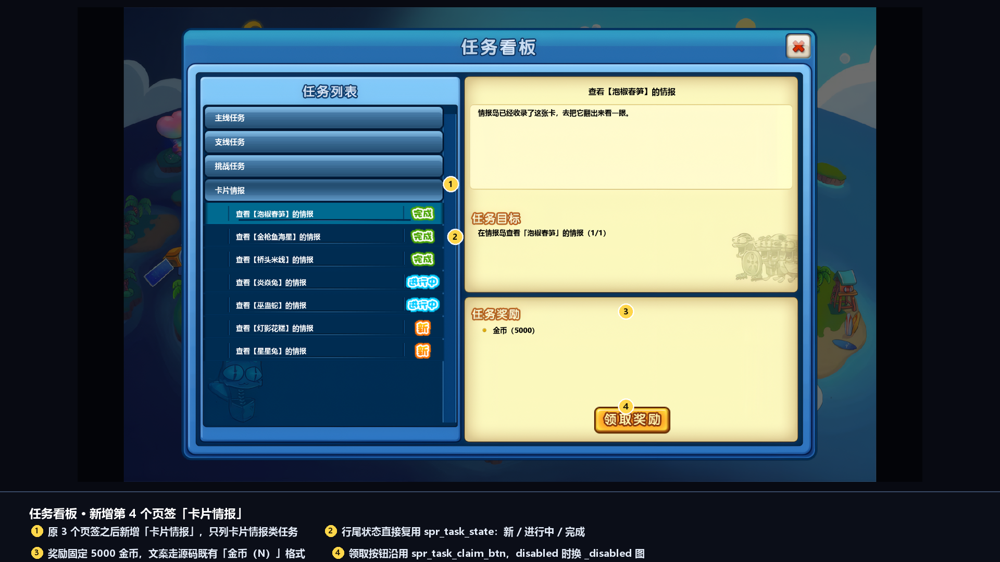
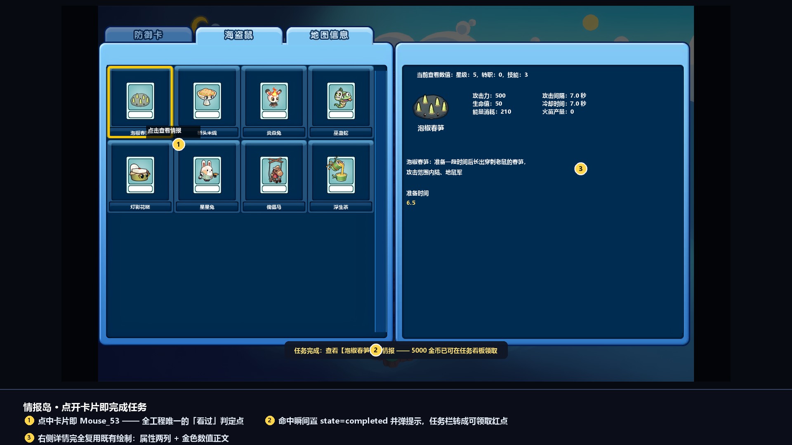
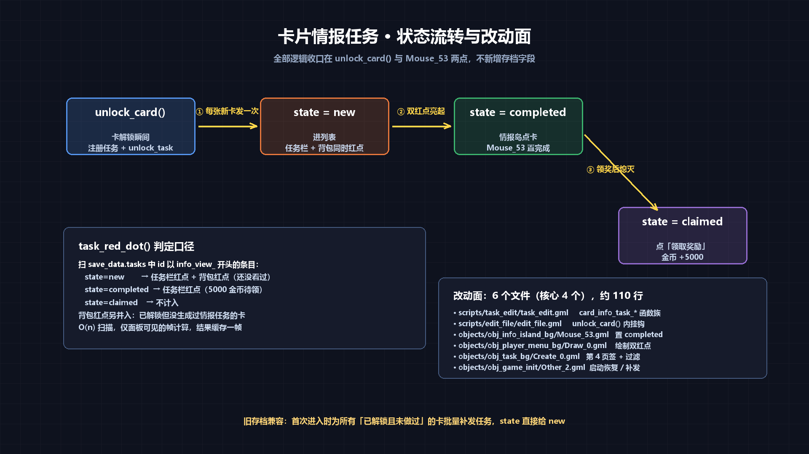

# 卡片情报任务 · 设计方案

> 需求：**每解锁一张新卡，出现一个任务「在情报岛查看这张卡的信息」，奖励 5000 金币；未完成时任务栏有红点，背包也有红点。**
>
> 本文给出可直接落地的实现方案（含文件:行触点、数据模型、代码骨架、边界处理），演示图见同目录 `img/`。
> 契约依据：AGENTS.md §1 铁律 / §4 唯一事实源 / §10 触点清单；错题本 `MISTAKES.md` 已扫。

---

## 0. 结论先行

| 项 | 决定 |
|---|---|
| 任务身份 | 动态生成，`id = "info_view_" + card_id`（如 `info_view_chunsun`） |
| 任务类型 | 新页签 `card_info_task`，与主线/支线/挑战并列第 4 页 |
| 完成判定 | **唯一落点**：`objects/obj_info_island_bg/Mouse_53.gml` 里 `select_card_index = hover_card_index` 之后 |
| 生成入口 | **唯一收口**：`scripts/edit_file/edit_file.gml` 的 `unlock_card()` 内部（先判 `is_card_unlocked`） |
| 奖励 | `{type:"gold", amount:5000}`，走既有 `obj_task_claim_btn/Mouse_4.gml` 的领奖逻辑，无需改 |
| 红点 | 新增 `task_red_dot()`，两处（任务栏 / 背包）同源，画在 `obj_player_menu_bg/Draw_0.gml` |
| 存档字段 | **不新增**。复用 `save_data.tasks[{id,state,progress}]` 的 `state` 四态 |
| 改动面 | 6 个文件（核心 4 个），约 110 行，全部是增量 |

---

## 1. 演示图

| 图 | 内容 |
|---|---|
|  | 任务看板新增第 4 页签「卡片情报」，行尾复用 `spr_task_state`，右侧详情 + 金币（5000） |
|  | 主界面底部菜单栏：任务按钮 + 背包按钮各一个红点（同源） |
|  | 情报岛点卡瞬间，`Mouse_53` 置完成并弹提示 |
|  | 四态流转 `unlock_card()` → new → completed → claimed，连同改动面清单 |

> 图由 `tools/mock_info_task.py` 生成，全部按游戏真实坐标/精灵尺寸复刻（PNG 像素当 draw 尺寸、`.yy` 的 `frames` 数组定帧序）。

---

## 2. 为什么这样设计（三个约束决定了形态）

### 2.1 不能"再加一个新的存档列表"

`scripts/task_edit/task_edit.gml` 已有完整的一套：`unlock_task` / `edit_task_state` / `get_task_state` / `add_task_progress` / `is_task_unlocked` / `get_task_index`，全部围绕 `global.save_data.tasks`（形状 `[{id, state, progress[]}]`）。
新增一个 `card_info_tasks` 列表 = 复制一遍增删改查 + 复制一遍面板绘制 + 老存档迁移，纯亏。**直接复用 `tasks`，用 `id` 前缀区分来源**。

### 2.2 不能逐点给 `unlock_card()` 的调用方插钩

`unlock_card(` 在全工程有 **20+ 处非注释调用**：`gacha_random_card.gml:462/:475/:498/:504`、`objects/*/Step_2.gml:190/:245/:431`、`Step_0.gml:32/:34/:40/:88/:203`、`Create_0.gml:164/:851`、`difficulty_rules.gml:236/:264/:342/:344`、`external_mod_system.gml:398`、`load_file.gml:42`、`mod_craft_evo_table.gml:431`。
逐点插 = 20 个改动点 + 以后每加一个发卡入口就漏一次。**只在 `unlock_card()` 内部插一次**。

### 2.3 "已解锁" ≠ "本次新解锁"

`scripts/edit_file/edit_file.gml:6-34` 的两个分支（已存在取 max / 不存在 push）**都 `return true`**，函数本身无法区分。所以挂钩必须自己在 push 前判 `is_card_unlocked(card_id)`（同文件 :55 起）。否则每次升级卡都会重复触发。

---

## 3. 数据模型

### 3.1 任务定义（运行时注册，不入 `task_init`）

```gml
// 每张卡一个，id 带前缀，便于一次扫出来
register_task("info_view_" + card_id, {
    "type"       : "card_info_task",          // 新类型，面板第 4 页按它过滤
    "title"      : "查看【" + card_name + "】的情报",
    "desc"       : "情报岛已经收录了这张卡，去把它翻出来看一眼。",
    "single_game": false,                     // 与战斗无关，别让 refresh_task_progress 清零
    "oneshot"    : false,
    "task_unlock": "none",                    // 不复用主线链，避免连锁解锁
    "requirements": [{
        "type"   : "card_info_view",          // 新 requirement 类型
        "card_id": card_id,
        "desc"   : "在情报岛查看「" + card_name + "」的情报",
        "require": 1
    }],
    "rewards": [{ "type": "gold", "amount": 5000 }]
})
```

**为什么 `type` 不用 `side_task`**：`objects/obj_task_bg/Create_0.gml:69-71` 的过滤是 `button_select == 1 && task_data.type == "side_task"` 这种硬编码三元判断，塞进 `side_task` 会污染支线页（支线现在有「卡片强化」「海底/遗迹/营地通关」等正式内容）。独立类型 + 第 4 页签，互不干扰。

**为什么 `task_unlock` 必须 `"none"`**：`objects/obj_task_manager/Create_0.gml:167-171` 完成时会 `unlock_task(task_data.task_unlock)`，不写 `"none"` 会去解锁一个不存在的 id。

### 3.2 进度与状态（复用四态）

| state | 含义 | 任务栏红点 | 背包红点 |
|---|---|---|---|
| `new` | 任务刚生成，还没在情报岛点过这张卡 | ✅ | ✅ |
| `viewed` | 列表里点开过任务行（`obj_task_line_bg/Mouse_4.gml:4` 写入） | ✅ | ✅ |
| `completed` | 已在情报岛点过卡，5000 金币待领 | ✅ | ❌ |
| `claimed` | 已领奖 | ❌ | ❌ |

- 「看过卡」→ 直接写 `completed`（不是 `viewed`）。`viewed` 的语义在这个工程里被 `obj_task_line_bg/Mouse_4.gml` 占用了——它是「点开任务行」，跟需求里「在情报岛查看卡片」不是一回事，不要混。
- `progress[0]` 置 1 作为完成标记，和面板上「（1/1）」的显示对齐（`obj_task_bg/Draw_0.gml` 的 requirement 行就是 `desc（progress/require）`）。

### 3.3 老存档怎么办

不新增字段 → 老存档里没有任何 `info_view_*` 条目，**红点自然为 0，不会误亮**。
首次进入时在启动链补发一次（见 §4.6），把「已解锁但没做过」的卡批量补成 `new`——这正是需求想要的「每解锁一张卡，就该有一个任务」。

---

## 4. 改动清单（核心 6 文件 + 4 处越界兜底，共 19 文件 / 约 300 行）

> 落地后的实际文件数比设计时多：多出来的都是「动态任务 id 让 `get_task_data` 可能返回 `undefined`」这一条带来的越界/空值兜底（`obj_task_manager`、`obj_task_claim_btn/Step_0`、`obj_task_line_bg/Draw_0`、`obj_task_bg/Destroy_0`），以及一项残留任务清理（`card_info_task_prune`）。核心逻辑仍是这 6 个文件。

### 4.1 `scripts/task_edit/task_edit.gml` — 新增函数族（追加，不改既有）

```gml
/// @function card_info_task_id(card_id)
function card_info_task_id(card_id){
	return "info_view_" + card_id
}

/// @function card_info_task_card_id(task_id)
/// @desc 反解：非本类任务返回 ""
function card_info_task_card_id(task_id){
	if (string_length(task_id) <= 10) return ""
	if (string_copy(task_id, 1, 10) != "info_view_") return ""
	return string_delete(task_id, 1, 10)
}

/// @function card_info_task_sync(card_id)
/// @desc 给一张卡补发情报任务（幂等：已注册过就只补 unlock_task，不动 state）
function card_info_task_sync(card_id){
	if (card_id == "") return
	var _tid = card_info_task_id(card_id)
	if (!ds_map_exists(global.task_pool, _tid)){
		var _name = card_info_task_name(card_id)
		register_task(_tid, { …见 §3.1… })
	}
	if (!is_task_unlocked(_tid)) unlock_task(_tid)
}

/// @function card_info_task_name(card_id)
/// @desc 取卡名：优先 plant_registry 的 shape0 name，取不到退回 card_id
function card_info_task_name(card_id){
	var _pd = get_plant_data(card_id)
	if (_pd != undefined){
		var _shapes = _pd[? "shapes"]
		if (ds_map_exists(_shapes, "0")){
			var _sd = _shapes[? "0"]
			if (_sd[? "name"] != undefined && string(_sd[? "name"]) != "") return string(_sd[? "name"])
		}
	}
	return card_id
}

/// @function card_info_task_complete(card_id)
/// @desc 情报岛点开卡片时调用：置 completed + progress 1 + 提示
function card_info_task_complete(card_id){
	if (card_id == "") return
	var _tid = card_info_task_id(card_id)
	if (!is_task_unlocked(_tid)) return
	var _st = get_task_state(_tid)
	if (_st == "completed" || _st == "claimed") return      // 幂等
	edit_task_progress(_tid, 0, 1)
	edit_task_state(_tid, "completed")
	show_notice("任务完成：查看【" + card_info_task_name(card_id) + "】的情报", 60)
}
```

> 注意 §1.3 铁律 3：`var _l = global.save_data.tasks; array_push(_l, ...)` 不回写 —— 上面的 `unlock_task` / `edit_task_*` 都是直接操作 `global.save_data.tasks`，没有这个问题。

### 4.2 `scripts/edit_file/edit_file.gml:20` — `unlock_card()` 内挂钩

在「卡片未解锁，添加新卡片」分支里，**在 `array_push` 之前**判重（此时还没进存档）：

```gml
    // 卡片未解锁，添加新卡片
    var new_card = { id: card_id, level: level, shape: shape, skill: skill,
                     max_level: level, max_shape: shape };

    array_push(global.save_data.unlocked_cards, new_card);
    card_info_task_sync(card_id);        // ← 新增：每解锁一张新卡，发一个情报任务
    save_file(global.save_slot);
    return true;
```

- 已存在分支（:11-18）**不加**：升级卡不该再发一次任务。
- `load_file.gml:42` 的 legacy 兜底 `unlock_card("chocolate_pult",0,0,5)` 会自动走这条路 —— 正是期望行为。

### 4.3 `scripts/difficulty_rules/difficulty_rules.gml:65` / `:101` — 两处旁路补一行

这两处**直接 `array_push` 绕过了 `unlock_card()`**（随机礼盒模式的 `lihe` / `wanpilong`），必须单独补：

```gml
// :65 附近（_lihe_index == -1 分支）
array_push(global.save_data.unlocked_cards,
    {id: "lihe", level: 0, shape: 0, skill: 0, max_level: 0, max_shape: 0});
card_info_task_sync("lihe");                       // ← 新增

// :101 附近（wnapilong 未解锁分支）
if (!_wanpilong_unlocked) array_push(global.save_data.unlocked_cards,
    {id: "wanpilong", level: 0, shape: 2, skill: 0, max_level: 0, max_shape: 2});
card_info_task_sync("wanpilong");                  // ← 新增（放在 if 外面也幂等）
```

> 这两张是「模式内临时发卡」，`random_gift_sync_unlock()` 在退出随机礼盒模式时会 `array_delete` 掉 `lihe`。信息岛任务留着不影响（任务只看 `save_data.tasks`），但需知悉：**卡被删了，任务还在**。可接受——奖励已领/未领都是玩家自己的账，重新进模式时 `card_info_task_sync` 幂等，不会重发。

### 4.4 `objects/obj_info_island_bg/Mouse_53.gml:14` — 唯一的完成落点

```gml
if not is_submenu_opened{
if hover_card_index != -1{
	global.audio.play(snd_button,0,0)
	select_card_index = hover_card_index
	// ★ 新增：卡片页签（info_button_select == 1）点中即视为"看过情报"
	if (info_button_select == 1){
		var _card_id = global.player_deck[| info_view[hover_card_index]];
		card_info_task_complete(_card_id);
	}
	…（原有 test_level 特判保持不变）
}
}
```

- `info_button_select == 1` 是「防御卡」页签（`Create_0.gml:10-12` 建三个按钮时 `button_index = 1/2/3`）。**只在卡片页算**，敌人在 tab2、关卡在 tab3，不参与。
- `info_view[]` 在 tab1 存的是 `global.player_deck` 的下标（`Draw_0.gml:153`），不是 id，所以要多绕一层。
- 用 `hover_card_index`（本帧刚点中的）而不是 `select_card_index`，避免 `open_focus_id` 从背包带过来时误判（`Draw_0.gml:119` 会在打开瞬间就设 `select_card_index`）。

### 4.5 `objects/obj_task_bg/Create_0.gml` — 第 4 页签 + 过滤

**建按钮（:15-23 之后追加）**：

```gml
var btn4 = instance_create_depth(x-400,y-125,depth-1,obj_task_select_btn)
btn4.btn_index = 3
btn4.btn_text = "卡片情报"
```

> 坐标：原三个在 `y-290 / y-235 / y-180`（间距 55），第 4 个接在 `y-125`。`spr_task_select_btn` 是 304×31 ×1.8 = 547×56，间距 55 略挤但与原版一致（原来就是 55）。

**过滤（:69-71）**：

```gml
		if (button_select == 0 && task_data.type == "main_task")
		|| (button_select == 1 && task_data.type == "side_task")
		|| (button_select == 2 && task_data.type == "challenge_task")
		|| (button_select == 3 && task_data.type == "card_info_task"){   // ← 新增
```

**落地时的三处修正**（写完方案后按实测几何调的，实际代码以这里为准）：

1. **首行下移**：`y-130` → `y-65`。第 4 页签占 `y-125`（场景 415，视觉 387~443），首行若留在 `y-130`（场景 410）会和页签压在一起。`y-65` = 场景 475。
2. **可见行数 11 → 9**：`obj_task_bg/Mouse_60.gml` 改成 `if y_offset >= 9` / `Mouse_61.gml` 改成 `array_length - 9`；`obj_task_line_bg/Step_2.gml` 改成 `y_offset + 8`。列表深蓝区实测覆盖场景 y 222~950，首行中心 475、9 行末行 891、分隔线 916，都在界内。
3. **隐藏行兜底**：`Step_2.gml` 补 `else { y = -9999 }`。原版靠「任务数 ≤ 可见数」隐式成立，第 4 页签卡一多，未定位的行会按 Create 时的 y 叠在可见区上。

另加**待办优先排序**：`refresh_task_list()` 在 `button_select == 3` 时按 `card_info_state_pri(state)`（new 0 / completed 1 / viewed 2 / 其他 3）做插入排序，同档保持解锁顺序；面板打开时若 `task_red_dot("task")` 为真，默认 `button_select = 3`。

### 4.6 `objects/obj_game_init/Other_2.gml:37` 之后 — 启动补发

`load_file(global.save_slot)` 之后再补一次（此时 `unlocked_cards` 已就位）：

```gml
// 卡片情报任务：为所有已解锁但没生成过任务的卡补发一次（老存档兼容）
// 幂等：已在 tasks 里的卡只做 unlock 兜底，state 不变
for (var _ci = 0; _ci < array_length(global.save_data.unlocked_cards); _ci++){
	card_info_task_sync(global.save_data.unlocked_cards[_ci].id)
}
```

- 位置必须在 `load_file` 之后、`global.gui_stack.to(room_menu)` 之前。
- 顺序依赖：`card_info_task_sync` → `register_task` 需要 `global.task_pool` 已建（`task_init()` 在 :22 已调），`get_plant_data` 需要 `global.plant_registry`（:30 已建）+ `cards_init()`（:31）/ `mod_manager`（:45）已跑。
- **实际落点**：`Other_2.gml` 的 :177-178（`global.player_name` / `global.total_time` 赋值）之后、debug 段之前，即 :180-185。这里 `load_file`、`obj_mod_manager`（:45，`external_mod_load_all()` 已在其中）都已跑完，mod 卡名也取得到，不用再挪。

### 4.7 `objects/obj_player_menu_bg/Draw_0.gml` — 双红点（现在只有 2 行）

现有全文：

```gml
draw_self()
draw_sprite_ext(spr_player_menu_bg_ex, 0, x-2, y-0.8, 0.9, 0.9, 0, c_white, 1)
```

追加：

```gml
// ── 红点：任务栏 / 背包同源 ──
var _dot_task = task_red_dot("task")
var _dot_pack = task_red_dot("package")

// 任务按钮 spr_task_btn：76×110 origin(38,110)，本对象 image_xscale=0.9
// 世界坐标 (x-370, y-5)，显示 68.4×99，可见区右上沿 ≈ (+68.4, -99+26)*0.9
if (_dot_task){
	var _tx = x - 370
	var _ty = y - 5
	draw_set_alpha(1)
	draw_set_colour(c_white)
	draw_circle(_tx - 38*0.9 + 68*0.9, _ty - 110*0.9 + 26*0.9, 12, false)   // 白描边
	draw_set_colour(make_colour_rgb(226, 52, 52))
	draw_circle(_tx - 38*0.9 + 68*0.9, _ty - 110*0.9 + 26*0.9, 9, false)    // 红点
}
if (_dot_pack){
	var _px = x - 45
	var _py = y - 5
	draw_set_colour(c_white)
	draw_circle(_px - 38*0.9 + 70*0.9, _py - 108*0.9 + 24*0.9, 12, false)
	draw_set_colour(make_colour_rgb(226, 52, 52))
	draw_circle(_px - 38*0.9 + 70*0.9, _py - 108*0.9 + 24*0.9, 9, false)
}
draw_set_colour(c_white)
draw_set_alpha(1)
```

> 红点圆心就是图上量出来的「图标圆角右上沿」，见 `img/_crop/menu_zoom.png` 的校准过程。

`task_red_dot(kind)` 放 `scripts/task_edit/task_edit.gml`（同一个文件方便维护）：

```gml
/// @function task_red_dot(kind)
/// @desc "task" → 有卡片情报任务处于 new/viewed/completed；"package" → 同上但 completed 不算
function task_red_dot(kind){
	for (var i = 0; i < array_length(global.save_data.tasks); i++){
		var _t = global.save_data.tasks[i]
		if (card_info_task_card_id(_t.id) == "") continue       // 只看情报任务
		var _s = _t.state
		if (_s == "claimed") continue
		if (kind == "task") return true                          // new/viewed/completed 都亮
		if (kind == "package"){
			if (_s != "completed") return true                   // 只有"还没看过"才亮背包
		}
	}
	return false
}
```

调用位置与频率：`obj_player_menu_bg` 只在 `room_map` 常驻，`Draw_0` 每帧一次 → O(任务数)，任务数 ≤ 卡数（当前上限 212 + 外部 mod），212 次字符串比较/帧可忽略。若嫌多，在 `Step` 里每 15 帧算一次存实例变量，`Draw` 只读缓存（图 4 里写的「缓存一帧」就是这意思，属可选优化）。

---

## 5. 红点口径（需求原文对照）

| 需求原文 | 落地 |
|---|---|
| 「没完成任务栏有红点」 | `state ∈ {new, viewed, completed}` → 任务按钮亮 |
| 「背包也有」 | `state ∈ {new, viewed}` → 背包按钮亮（`completed` = 已经看过了，背包不该再催） |
| 「每解锁一张新卡，出现一个任务」 | `unlock_card()` 未解锁分支 + `difficulty_rules` 两处旁路 + 启动补发，三处全覆盖 |
| 「奖励 5000 金币」 | `rewards:[{type:"gold", amount:5000}]`，领奖走既有 `obj_task_claim_btn/Mouse_4.gml`（:9-11 `global.save_data.player.gold += amount`） |

> ⚠️ 领奖后**必须** `save_file`。`obj_task_claim_btn/Mouse_4.gml` 现在没调 `save_file`（依赖别处保存），金币可能丢。方案里建议在该文件 `edit_task_state(task_id,"claimed")` 之后补 `save_file(global.save_slot)`——顺手修掉这个隐患（第 7 个文件，+1 行）。

---

## 6. 边界与坑（逐条对应工程既有事实）

1. **`register_task` 用 `ds_map_add`**（`task_init.gml:6`）→ 同 id 二次注册**静默失败**。所以 `card_info_task_sync` 必须先 `ds_map_exists` 再注册，不能靠"覆盖"。
2. **`unlock_task` 不重置 progress**（`task_edit.gml:2` 的 `if !is_task_unlocked`）→ 幂等安全，重复调用不会把进度清零。
3. **`refresh_task_progress` 会跳过 completed/claimed**（`obj_task_manager/Create_0.gml:42`）→ 情报任务进 `completed` 后不会被战斗逻辑改回去。
4. **`single_game` 必须 false**：`obj_task_manager/Create_0.gml:174-178` 对 `single_game` 未达成的任务**清零 progress**。情报任务跟单局无关，设 true 会每次进战斗都被清空。
5. **`card_info_view` 这个 requirement 类型不会被 `refresh_task_progress` 处理** → 它的 `complete_count` 永远不 +1，于是不会被战斗逻辑误判完成。完成只由 `card_info_task_complete` 写。这是**有意为之**，别去 `refresh_task_progress` 里加分支。
6. **`obj_task_bg` 没有 Step 事件**（目录只有 Create/Destroy/Draw/Mouse_60/61）→ 红点/状态刷新不能挂在这里，只能靠 `Mouse_4` 或 Draw。
7. **`obj_player_menu_btn` 没有 Draw 事件**（`.yy` eventList 只有 Create_0 / Mouse_4 / Mouse_10 / Mouse_11）→ 红点必须画在 `obj_player_menu_bg/Draw_0.gml`，或在 btn 上新增 Draw_0 + 同时改 `.yy` 加 `eventType:8`。方案选前者（改 1 个文件 vs 改 1 个 gml + 1 个 yy）。
8. **`spr_task_state` 只有 4 帧**，state→index 已固定 `new0/viewed1/completed2/claimed3`（`obj_task_line_bg/Draw_0.gml:29-42`）→ 不要新增第 5 态。
9. **`obj_task_bg/Mouse_60/61` 的可见行数硬编码**（原版 11：`if y_offset > 11` / `array_length - 11`）→ 加第 4 页签后实测改成 **9**（首行同时 `y-130` → `y-65`，见 §4.5 的修正说明），`obj_task_line_bg/Step_2.gml` 的可见上界同步改 `+8` 并补 `else { y = -9999 }` 隐藏行。**改首行或改可见行数时，这三个文件必须一起动**，否则行会串位或叠到可见区外面。
10. **旧存档 `tasks` 兜底**（`load_file.gml:185-193`）只在 `tasks` 缺失时灌 5 条默认任务 → 已有存档不会触发，所以启动补发必须单独写（§4.6），不能指望这里。
11. **`is_task_complete` 查的是 `completed_tasks`**（`task_edit.gml:94`），与 `state` 无关。情报任务永远不进 `completed_tasks`（那是 `remove_task(id,true)` 的产物，任务被移除才记）→ 不要用 `is_task_complete` 判情报任务。
12. **卡名取法**：`get_plant_data(card_id)[? "shapes"][? "0"][? "name"]`（`card_registry.gml:114`）。取不到就退回 `card_id`——外部 mod 卡在 `obj_mod_manager` 建好之前取不到，靠兜底不出错。

---

## 7. 验证清单

| # | 动作 | 期望 |
|---|---|---|
| 1 | `tools/verify_gml.ps1` 跑改动路径 | 全绿（BOM / 括号配平 / 字节数） |
| 2 | 新存档开局 → 点开任务看板 | 出现第 4 页签「卡片情报」 |
| 3 | 通关一关拿到首通卡 | 任务看板出现「查看【卡名】的情报」，行尾橙色 `new` 角标；任务按钮 + 背包按钮同时亮红点 |
| 4 | 进情报岛点那张卡 | 弹 `任务完成：查看【卡名】的情报`；背包红点灭；任务栏红点仍在 |
| 5 | 回任务看板 → 卡片情报页 → 点行 → 点领取 | 金币 +5000；`show_notice("奖励已领取")`；两个红点全灭 |
| 6 | 再点同一张卡 3 次 | 不重复弹提示、不重复加钱（幂等） |
| 7 | 升级已有卡（背包强化） | **不**产生新任务 |
| 8 | 老存档（无 `info_view_*`）进游戏 | 首次进入后，所有已解锁卡都补出情报任务（`new`） |
| 9 | 随机礼盒模式开关 | `lihe` / `wanpilong` 发卡时也补任务；退出模式卡被删，任务留着不报错 |
| 10 | 领奖后强杀进程再进 | 金币还在（依赖 §5 补的 `save_file`） |
| 11 | 卸载一张外部 mod 卡后进游戏 | 它的情报任务被 `card_info_task_prune()` 清掉，红点不残留；`mod_state.json` 只是禁用（卡还在存档里）时任务保留 |
| 12 | 任务数 > 9 时滚轮上下翻 | 每次翻 9 行；翻到末页不越界；未定位的行不叠在可见区 |

---

## 8. 落地顺序（建议）

1. `scripts/task_edit/task_edit.gml` — 加函数族（§4.1 + `task_red_dot`）
2. `scripts/edit_file/edit_file.gml` — `unlock_card()` 挂钩（§4.2）
3. `scripts/difficulty_rules/difficulty_rules.gml` — 两处旁路（§4.3）
4. `objects/obj_info_island_bg/Mouse_53.gml` — 完成落点（§4.4）
5. `objects/obj_task_bg/Create_0.gml` — 第 4 页签（§4.5）
6. `objects/obj_game_init/Other_2.gml` — 启动补发（§4.6）
7. `objects/obj_player_menu_bg/Draw_0.gml` — 双红点（§4.7）
8. `objects/obj_task_claim_btn/Mouse_4.gml` — 补 `save_file`（§5 的顺手修复）
9. `CHANGELOG.md` 记一条；`tools/verify_gml.ps1` 全绿

---

## 9. 附：演示图生成器

`tools/mock_info_task.py` — 从真精灵/真坐标复刻 UI 的 mockup 生成器，4 个图函数 `fig_taskboard()` / `fig_menu_reddot()` / `fig_info_island()` / `fig_flow()`。

关键实现约定（踩过的坑，别改回去）：

- **draw 尺寸取 PNG 像素**，origin 取 `.yy`。工程里多张精灵 png 是 `.yy` 尺寸的 2 倍（`spr_info_island_bg_1` 1892×1948 vs yy 473×487、`spr_package_slot_bg` 98×114 vs yy 49×57），按 `.yy` 缩放会小一半。
- **帧顺序读 `.yy` 的 `frames` 数组**，不能按文件名排序（uuid 名字排序 = 随机）。
- 游戏画面 1:1 画在 1920×1080 的 SCENE 上，最后整体缩 0.845 贴到画布，底部留深色图例条——标注不压 UI。
